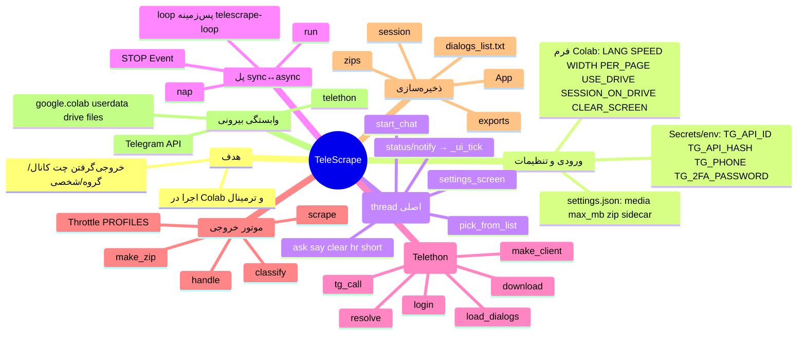
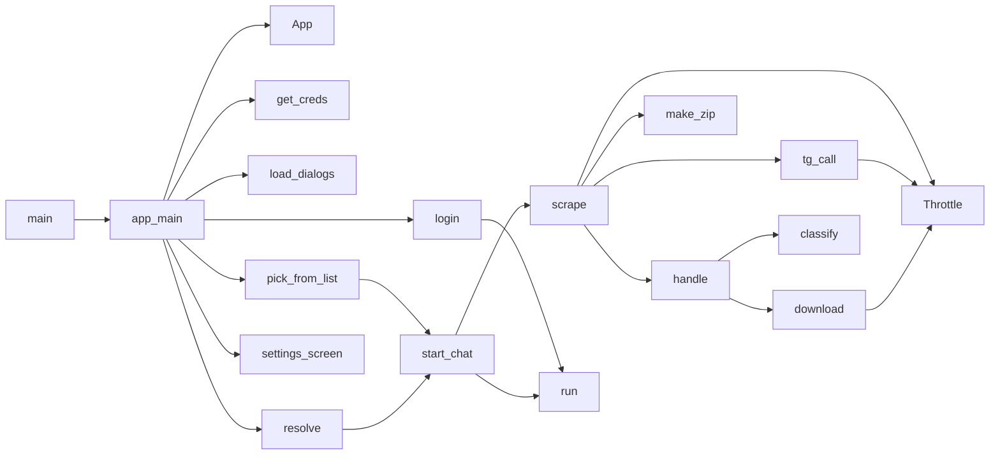

# Mindmap — TeleScrape

> مرجع قوانین: [Instructions for Ai.md](Instructions%20for%20Ai.md)
> علامت‌ها: ✅ = تأییدشده با کد، ◻️ = استنباط/تأییدنشده.

## درخت سلسله‌مراتبی (جزئیات)

- **نقطه‌ی ورود** ✅: `main()` → `app_main()`
- **پیکربندی** ✅
  - ثابت‌ها: `TEXT_EXT`, `MB`, `STALL_SECS=120`, `BACKOFF_BASE=5.0`, `SECRET_NAMES`, `PROFILES`, `DEFAULT_EXT`, `RETRY_ERRORS`
  - متن‌ها: دیکشنری `S` (`fa`, `en`) و `t()`
- **استثناهای سفارشی** ✅: `Stopped`, `DiskLow`, `LoginAbort`
- **رابط/UI** ✅: `hr`, `say`, `clear`, `ask` (تبدیل ارقام فارسی/عربی با `_DIGITS`), `pause`, `short`, `short_err`, `status`, `notify`, `_ui_tick`, `_ui_end`
- **همزمانی** ✅: `_bg_loop`, `run`, `nap`, `STOP`, `PROG`
- **سرعت/خنک‌سازی** ✅: `Throttle` (`batch_pause`, `after_download`, `flood`, `ok`), `tg_call`
- **فایل/ابزار** ✅: `sanitize`, `load_json`, `save_json`, `_rm`, `_chmod`, `build_link`, `fmt_date`, `safe_ext`, `classify`, `make_zip`
- **اعتبارنامه** ✅: `get_secret`, `norm_phone`, `get_creds`
- **حالت برنامه** ✅: `App` (`DEFAULTS`, `save_settings`, `session_path`, `lock_session`, `delete_session`, `cleanup_legacy`)
- **چت‌ها** ✅: `make_item`, `load_dialogs`, `_match`, `item_row`, `pick_from_list`, `TME_RE`, `USERNAME_RE`, `resolve`, `export_list`
- **خروجی‌گیری** ✅: `download`, `count_msgs`, `scrape`, `report`, `offer_download`
- **منوها و ورود** ✅: `start_chat`, `settings_screen`, `login`, `make_client`, `_disconnect`, `app_main`

## روابط اصلی

| رابطه | وضعیت |
|---|---|
| تمام فراخوانی‌های بالا | ✅ از کد خوانده شده |
| ارتباط با ریپازیتوری‌های دیگر کاربر | ◻️ هیچ شواهدی وجود ندارد؛ فرض نشده |
| رفتار داخلی Telethon (مثلاً flood sleep) | ◻️ از مستندات Telethon، در این بررسی اجرا نشده |

## زیرساخت تست / بیلد / استقرار

- تست: ندارد ✅ (فهرست فایل‌ها)
- بیلد/CI: ندارد ✅
- استقرار: چسباندن در سلول Colab یا اجرای مستقیم پایتون ✅ (README)
