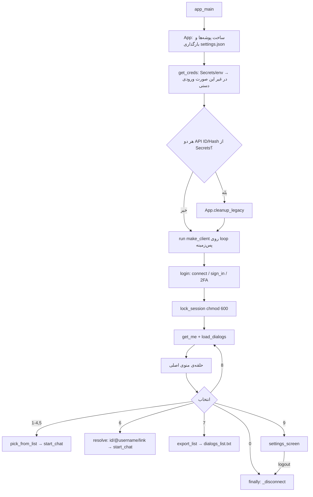
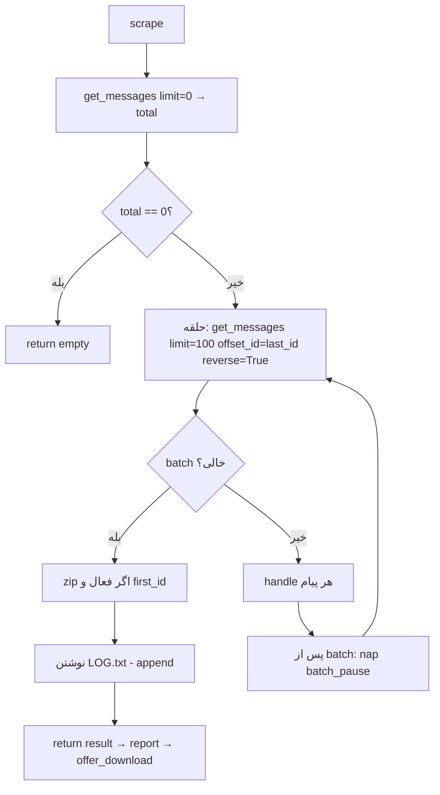

# Workflow — TeleScrape

> مرجع قوانین: [Instructions for Ai.md](Instructions%20for%20Ai.md)
> همه‌ی موارد زیر از خواندن `telescrape_v3.py` (کامیت پایه `6cf416c`) استخراج شده‌اند. شماره‌خط‌ها مربوط به همان نسخه‌اند و با تغییر کد ممکن است جابه‌جا شوند.

## 1. Startup sequence

1. **بالای فایل:** پارامترهای فرم Colab (`LANG`, `SPEED`, `WIDTH`, `PER_PAGE`, `USE_DRIVE`, `SESSION_ON_DRIVE`, `CLEAR_SCREEN`) به‌صورت متغیرهای سراسری تعریف می‌شوند (خطوط ۲۱–۲۷). در ترمینال باید مستقیماً در فایل ویرایش شوند.
2. `_ensure("telethon")` اگر `telethon` import نشود، `pip install -q telethon` را اجرا می‌کند (بدون پین نسخه؛ `requirements.txt` می‌گوید `>=1.40` ولی این مسیر آن را اعمال نمی‌کند).
3. `IN_COLAB = "google.colab" in sys.modules`.
4. `if __name__ == "__main__": main()` ← `main()` ← `app_main()`.
5. `main()` استثناهای `LoginAbort` (پیام `login_abort`) و `KeyboardInterrupt`/`EOFError` (پیام `bye`) را می‌گیرد.

## 2. Entry point: `app_main()`



- **Credentials** (`get_creds`, `get_secret`): ابتدا Colab Secrets (`google.colab.userdata`) سپس متغیر محیطی؛ نام‌ها از `SECRET_NAMES` (`TG_API_ID`/`API_ID`, `TG_API_HASH`/`API_HASH`, `TG_PHONE`/`PHONE`, `TG_2FA_PASSWORD`). API Hash باید ۳۲ کاراکتر hex باشد. مقدار ناقص به‌صورت دستی پرسیده می‌شود (`getpass` برای Hash). شماره با `norm_phone` نرمال می‌شود (مثلاً `09xxxxxxxxx` ← `+98...`).
- **API ID/Hash روی دیسک نوشته نمی‌شود.** فقط فایل session تلگرام (`session/tg_<api_id>.session`) ذخیره می‌شود.

## 3. Threading and the sync↔async bridge

```mermaid
sequenceDiagram
    participant Main as Main thread (sync UI)
    participant Loop as Thread "telescrape-loop" (asyncio)
    participant TG as Telegram
    Main->>Loop: run(coro) → run_coroutine_threadsafe
    loop هر 0.3 ثانیه
        Main->>Main: cf.wait + _ui_tick (چاپ status/notify)
    end
    Loop->>TG: درخواست‌ها (Telethon)
    Loop-->>Main: نتیجه (fut.result)
    Note over Main,Loop: Ctrl+C / دکمه ■: اگر stoppable، بار اول STOP.set؛ بار دوم یا بعد از 90s → cancel
```

- منطق رابط (ورودی `input`) فقط در thread اصلی است؛ Telethon فقط در thread `telescrape-loop` اجرا می‌شود (`_bg_loop`).
- thread کارگر هرگز `print` نمی‌کند: `status(text)` یک خط وضعیت و `notify(text)` پیام‌های صف‌شده را منتشر می‌کند؛ `_ui_tick` در thread اصلی می‌کشد.
- توقف: `STOP` (`threading.Event`) را `nap`, `tg_call`, `download` و حلقه‌ی `scrape` بررسی می‌کنند و `Stopped` پرتاب می‌شود.

## 4. Login flow (`login`)

1. `client.connect()`؛ اگر `is_user_authorized()` درست بود، پایان.
2. `send()` تا ۵ بار `send_code_request(phone)`؛ روی `FloodWaitError` ← `LoginAbort`؛ روی خطای دیگر شماره دوباره پرسیده می‌شود.
3. تا ۶ بار کد پرسیده می‌شود (`r` = ارسال دوباره). `PhoneCodeExpiredError` ← کد جدید؛ `PhoneCodeInvalidError` ← پیام خطا؛ `SessionPasswordNeededError` ← رفتن به رمز دو مرحله‌ای.
4. تا ۵ بار رمز دو مرحله‌ای (از `TG_2FA_PASSWORD` یا `getpass`)؛ `PasswordHashInvalidError` ← تلاش مجدد.
5. شکست نهایی ← `LoginAbort` ← `main()` پیام می‌دهد و خارج می‌شود.

## 5. Chat listing and selection

- `load_dialogs(client)`: `client.iter_dialogs()` با timeout ۶۰۰ ثانیه، تا ۳ تلاش روی `RETRY_ERRORS`. دسته‌بندی: `channel` (`d.is_channel and not d.is_group`)، `group` (`d.is_group`)، `bot`/`private` (`d.is_user` بر اساس `entity.bot`)، بقیه رد می‌شوند.
- `pick_from_list`: صفحه‌بندی (`PER_PAGE`، حداقل ۵)، دستورها `n`/`p`/`s`/`r`/`0`; عدد: شماره‌ی لیست یا (اگر خارج از بازه) تطبیق با آیدی دیالوگ.
- `resolve(client, text, items)`: آیدی عددی (ابتدا تطبیق دقیق با لیست، سپس آیدی خام)، `@username`، لینک `t.me/...` (شامل `t.me/c/<id>/...`). لینک دعوت (`t.me/+...` یا `joinchat`) ← `None` (پشتیبانی نمی‌شود). هر خطا ← `None` (نمایش `not_found`).

## 6. Export workflow: `start_chat` → `scrape`

**نقطه‌ی شروع:** `start_chat(app, client, item)` تعداد پیام را می‌گیرد (`count_msgs`)، سرصفحه را نشان می‌دهد و با Enter شروع می‌کند (`0` = لغو).



**برای هر پیام (`handle`):**
1. `classify(m)` ← `Service | Photo | Voice | VideoMessage | Sticker | GIF | Video | Music | File | Other | Text`.
2. در `metadata.txt` یک بلوک (`[id] [kind] [Author] [Date]`، `Caption`، `Reply to` با لینک در صورت امکان، و `File:` یا وضعیت رد) نوشته می‌شود.
3. `Text` ← فایل `<id:06d>_Text.txt` + افزودن به `all_texts.md`.
4. نوع مدیا ← نام `<id:06d>_<Kind><ext>` (`safe_ext`). اگر مدیا خاموش، فایل بزرگ‌تر از `max_mb`، یا فایل غیرخالی از قبل موجود باشد: رد می‌شود (`stats["skipped"]`) و در metadata ثبت می‌شود. در غیر این صورت `download(...)`.
5. پس از دانلود موفق: اختیاری فایل `<path>.info.txt` (اگر `sidecar` روشن)، سپس `nap(th.after_download(real_size))`.
6. کپشن/متن مدیا نیز در `all_texts.md` با سرصفحه‌ی `### Message ...` ثبت می‌شود.

**`download(client, m, path, size, th, tag)`:**
- حداکثر ۴ تلاش. هر تلاش: بررسی فضای دیسک (`free < max(size*1.1, 200MB)` ← `DiskLow`)، دانلود به `<path>.part`، نظارت هر ۱ ثانیه روی پیشرفت.
- بدون پیشرفت بیش از `STALL_SECS` (۱۲۰ ثانیه) ← `asyncio.TimeoutError("stalled")` ← retry با backoff (`BACKOFF_BASE * 2**attempt`، حداکثر ۴۰ ثانیه).
- `FloodWaitError` ← `th.flood(seconds)` و `nap`.
- موفقیت: `os.replace(.part → path)`؛ فایل‌های `.part` همیشه در `finally` پاک می‌شوند.

**پایان و خروجی:**
- zip (اگر `zip` فعال و `first_id` موجود و اجرا قطع نشده): `zips/<name>_<pid>_<first_id>_<last_done>.zip` در thread جدا (`asyncio.to_thread(make_zip, ...)`).
- `LOG.txt` همیشه با حالت append نوشته می‌شود (زمان شروع، مدت، آمار، حداکثر ۲۰۰ خطای ثبت‌شده).
- `report(res)` خلاصه را چاپ می‌کند؛ `offer_download(zip)` فقط در Colab پرسش دانلود مرورگر را می‌پرسد.

**اجرای دوباره روی همان چت:** `metadata.txt` و `all_texts.md` با حالت `"w"` از نو نوشته می‌شوند؛ مدیایی که فایل غیرخالی‌اش موجود است دانلود نمی‌شود.

## 7. Cooldown / rate-limit flow

- `Throttle(profile)` با `PROFILES` (`gentle`/`normal`/`fast`):
  - `batch_pause()` بین هر ۱۰۰ پیام، `after_download(nbytes)` بعد از هر فایل، و در صورت رسیدن به `n` فایل یا `mb` مگابایت استراحت بلند اضافه می‌شود.
  - `flood(seconds)`: ضریب `mult` × ۱٫۵ (سقف ۴٫۰) و بازگشت `seconds + uniform(2,8)`.
  - `ok()`: `mult = max(1.0, mult * 0.95)` بعد از هر موفقیت.
- `tg_call(factory, th, timeout=90, tries=6)`: `asyncio.wait_for` + retry روی `RETRY_ERRORS` با backoff (حداکثر ۶۰ ثانیه) + انتظار روی `FloodWaitError`؛ پس از اتمام تلاش‌ها آخرین خطا پرتاب می‌شود.
- در `make_client`: `flood_sleep_threshold = 60` تنظیم شده؛ طبق رفتار مستند Telethon، floodهای کوتاه‌تر از ۶۰ ثانیه خودکار توسط خود Telethon منتظر می‌مانند (**Not verified** در این بررسی؛ استنباط از مستندات Telethon).

## 8. Settings screen (`settings_screen`)

گزینه‌ها: ۱ مدیا، ۲ سقف حجم MB، ۳ زیپ، ۴ فایل info، ۵ چرخش سرعت (`gentle→normal→fast`)، ۶ خروج از حساب + حذف session، ۰ برگشت. `settings.json` فقط `media`, `max_mb`, `zip`, `sidecar` را ذخیره می‌کند؛ **سرعت (`app.speed`) ذخیره نمی‌شود** و هر اجرا از `SPEED` شروع می‌شود.

## 9. Error handling and logging

- خطای یک پیام: گرفته می‌شود، `stats["errors"]` افزایش می‌یابد، `"<id>: <Type>: <msg>"` در `LOG.txt` ثبت می‌شود و اجرا ادامه می‌یابد.
- `Stopped`/`DiskLow`/خطای مرگبار: حلقه قطع می‌شود، `interrupted=True` با `reason` (`stop` / `disk` / متن خطا)، فایل‌های دانلودشده می‌مانند، zip ساخته نمی‌شود.
- هیچ سیستم لاگ ساختاریافته‌ای (مثل `logging`) استفاده نشده؛ فقط `LOG.txt` هر چت و پیام‌های رابط.

## 10. Build, test, deployment, release

- **Build:** ندارد (اسکریپت تک‌فایل).
- **Test:** ندارد (هیچ تست/CI در ریپازیتوری نیست).
- **Deployment:** کاربر محتوای `telescrape_v3.py` را در یک سلول Colab می‌چسباند یا با `python telescrape_v3.py` اجرا می‌کند (README).
- **Release:** فرآیند رسمی ثبت نشده است؛ نسخه فقط در نام فایل (`v3`) و عنوان docstring دیده می‌شود.
